<h1 align="center">PULSEMR</h1>

<p align="center">
  <strong>Adaptive mixed-reality CPR guidance</strong>
  <br>
  An interactive 3D research demonstration with a ground-truth-labelled dataset
</p>

<p align="center">
  
  
  
  
  
</p>

<p align="center">
  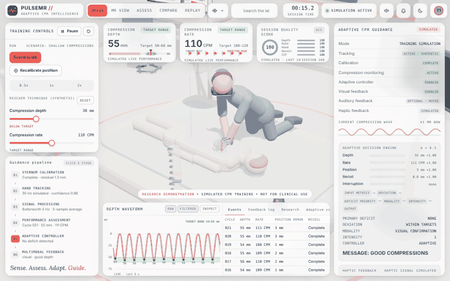
</p>

PULSEMR simulates a CPR training session in a 3D lab, end to end. A synthetic rescuer gives chest compressions on a manikin. The app then runs the full chain:

1. tracks the rescuer's hands at 30 Hz
2. filters the signal
3. detects every compression
4. scores depth, rate, hand position, recoil and interruptions against the resuscitation guidelines
5. lets an **adaptive feedback controller** decide which visual, audio or haptic cue to give, while a classic **static controller** judges the same compressions side by side

Everything runs in the browser and is deterministic. Because the motion is generated, the true value of every measurement is known, so you can see exactly where errors creep in.

The repository also contains **PULSEMR-SIM**, a dataset of about 9 MB:

- ten fully labelled sessions
- the outputs of the four experiments behind the PULSEMR manuscript
- the code that regenerates them bit for bit
- a [data-descriptor paper](docs/paper/PULSEMR-SIM_dataset_paper.pdf)

> [!IMPORTANT]
> **Research demonstration, not for clinical use.** PULSEMR does not connect to a headset or a manikin and cannot measure a real person. It must not be used for clinical decisions or as CPR certification.

---

## Table of contents

- [Quick start](#quick-start)
- [Tour of the app](#tour-of-the-app)
- [How it works](#how-it-works)
- [The dataset](#the-dataset)
- [Reproduce the results](#reproduce-the-results)
- [Learn with PULSEMR](#learn-with-pulsemr)
- [Project structure](#project-structure)
- [Keyboard shortcuts](#keyboard-shortcuts)
- [Development](#development)
- [Citation, licence and disclaimer](#citation-licence-and-disclaimer)

## Quick start

### Option 1: Run a local server (recommended)

```bash
git clone https://github.com/<your-username>/pulsemr.git
cd pulsemr
npm start            # zero-dependency server, nothing to install
```

Open <http://localhost:8080>. Any static server works too, for example `python3 -m http.server 8080`.

### Option 2: Open the HTML file

Double-click `index.html`. The app also works from `file://`, because three.js is bundled in `vendor/`.

### Option 3: Publish on GitHub Pages

1. Push the repository to GitHub.
2. Open **Settings → Pages**.
3. Choose **Deploy from a branch**, branch `main`, folder `/ (root)`.

The live app appears at `https://<your-username>.github.io/pulsemr/`.

On first load, the app shows a short demonstration: about 15 s of good compressions followed by a shallow phase, so you can watch the controller react. Touch any control to take over.

**Requirements:** a browser with WebGL (any recent Chrome, Edge, Firefox or Safari). The fonts load from Google Fonts. Offline, the app falls back to system fonts.

## Tour of the app

PULSEMR has five modes (keys **1** to **5**). Each one shows the same live session from a different angle.

### 1 · Train: the live session

<p align="center">
  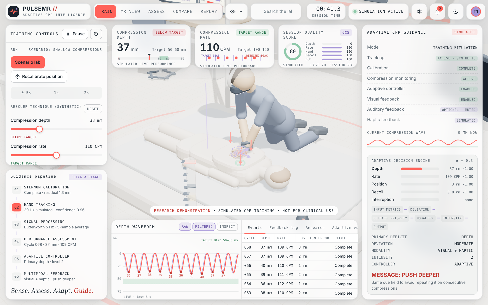
</p>

The default view, shown here during the *Shallow compressions* scenario.

- **Left:** the training controls and the six-stage guidance pipeline, from sternum calibration to multimodal feedback. A stage lights up as data passes through it.
- **Top:** live depth, rate and session-quality score cards. Depth reads 37 mm against the 50–60 mm target.
- **Bottom:** the depth waveform (raw, filtered and inspect views) and a table of every detected compression.
- **Right:** the adaptive decision engine. It shows each metric's deviation, its personalised weight (`×2.00` for the recurring depth deficit), the chosen modality and intensity, and the resulting message: **PUSH DEEPER**.

<table>
<tr>
<td width="50%">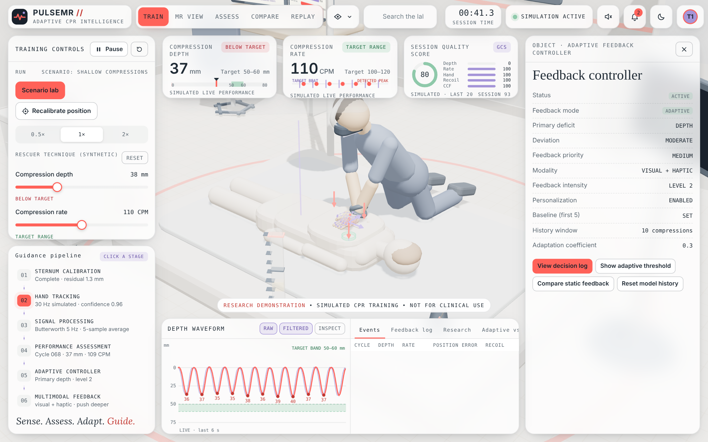</td>
<td width="50%">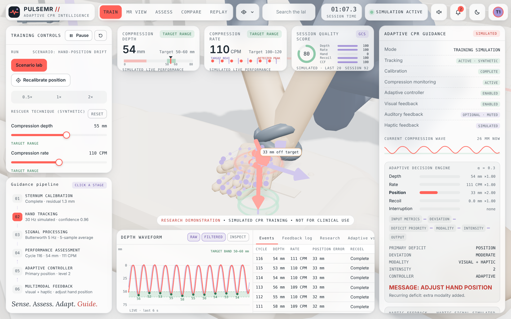</td>
</tr>
<tr>
<td><b>Click any object in the lab.</b> The feedback controller's panel shows its live state: primary deficit, deviation, modality, intensity, five-compression baseline, ten-compression history window and adaptation coefficient 0.3.</td>
<td><b>Hand close-up during hand-position drift.</b> The tracked palm sits 33 mm off the sternum target. The controller asks the trainee to adjust hand position, and because the deficit keeps recurring it adds an extra modality.</td>
</tr>
</table>

### 2 · MR view: what the trainee would see

<p align="center">
  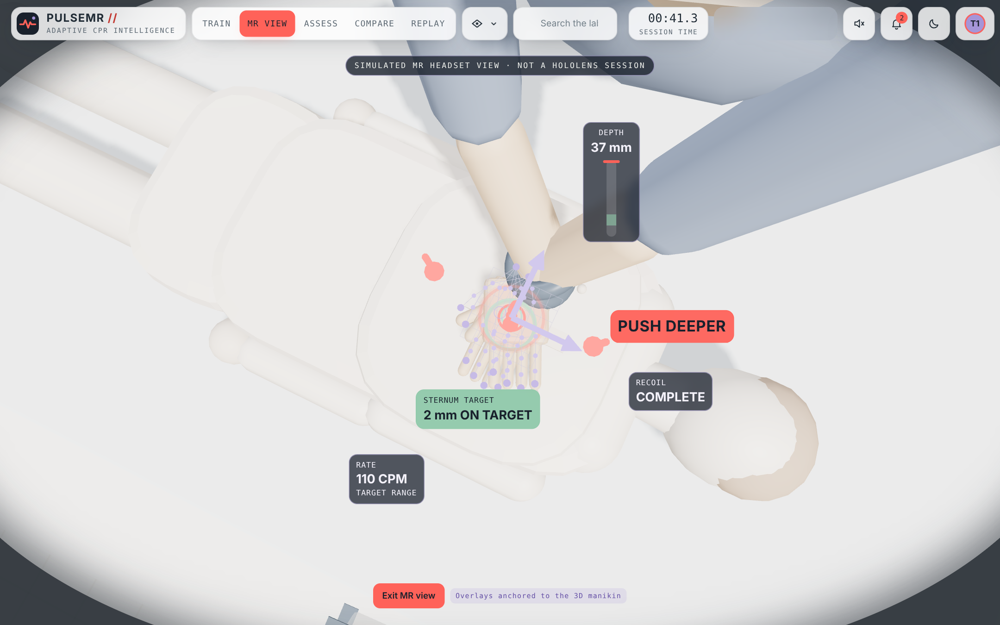
</p>

This is a simulated headset view with overlays anchored to the manikin:

- a depth gauge
- rate and recoil labels
- the sternum target
- the current cue (coral **PUSH DEEPER**)

It is explicitly labelled as a simulation, not a HoloLens session.

### 3 · Assess: the session report

<p align="center">
  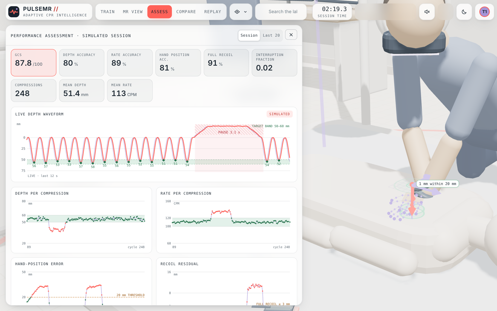
</p>

The report gives the session's guideline compliance score (GCS) and its components: depth, rate, hand position, full recoil and interruption fraction. Below them are the live depth waveform and per-compression charts for depth, rate, hand-position error and recoil residual. Switch between the whole session and the last 20 compressions. The session shown went through *Mixed errors* and then *Frequent interruptions*: the pause is visible in the waveform, and the hand error rises above the 20 mm threshold.

### 4 · Compare: reported findings and policy comparison

<table>
<tr>
<td width="50%">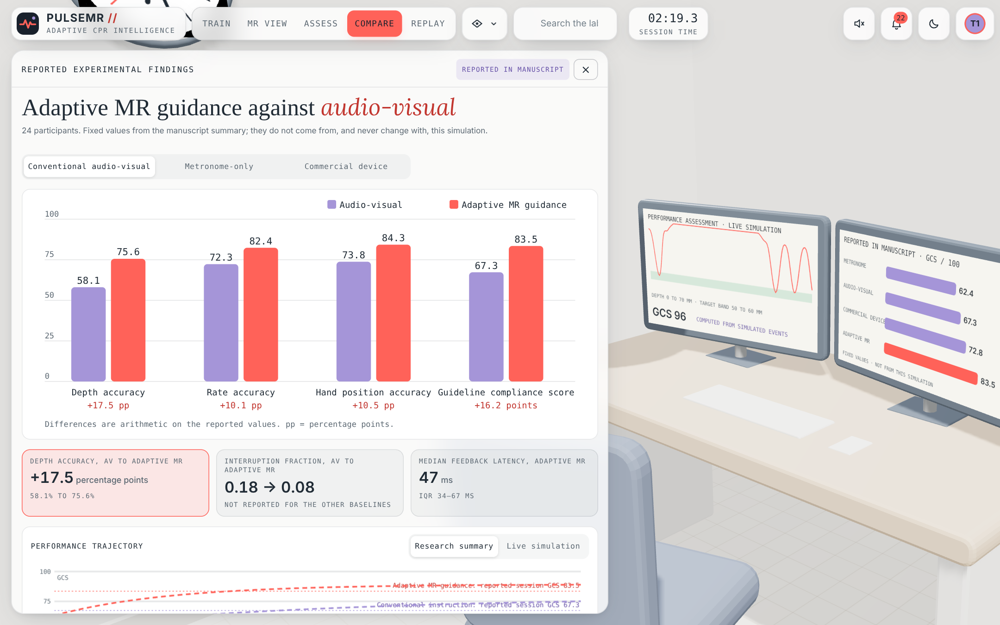</td>
<td width="50%">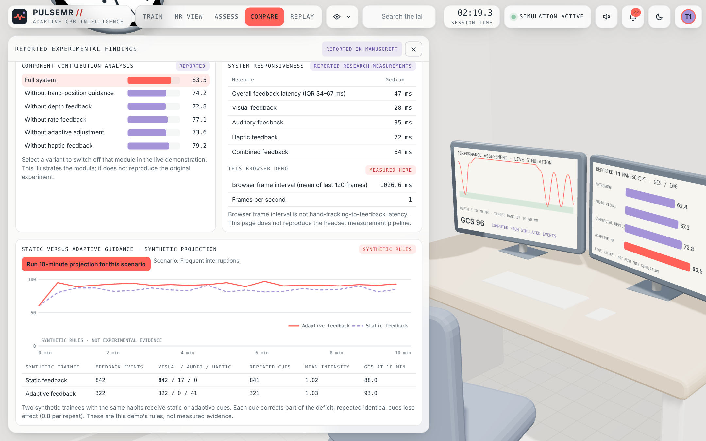</td>
</tr>
<tr>
<td><b>Reported findings.</b> The manuscript's 24-participant results for adaptive MR guidance against each baseline (audio-visual, metronome-only, commercial device). They are fixed values, clearly labelled as reported, and never change with the simulation.</td>
<td><b>Ablation, responsiveness and projection.</b> Component-contribution results and reported latencies. Select a variant to switch that module off in the live simulation. Below them is a 10-minute <b>synthetic projection</b> of static versus adaptive feedback. The "this browser demo" frame-interval row is measured live; this screenshot was captured with software rendering, hence the very low FPS.</td>
</tr>
</table>

### 5 · Replay: scrub through the session

<p align="center">
  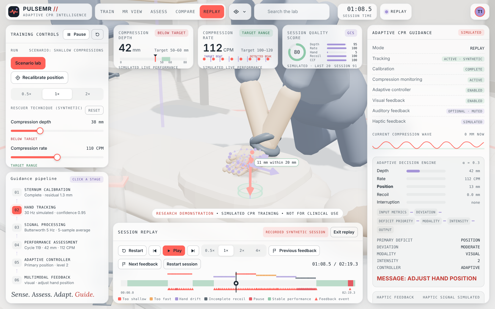
</p>

The last 10 simulated minutes are kept in a ring buffer. Scrub the timeline, or press the arrow keys to step from one compression to the next, and the 3D scene, waveform and metrics follow. This screenshot is paused on a hand-position cue.

### Scenario lab, themes and phones

<table>
<tr>
<td width="50%">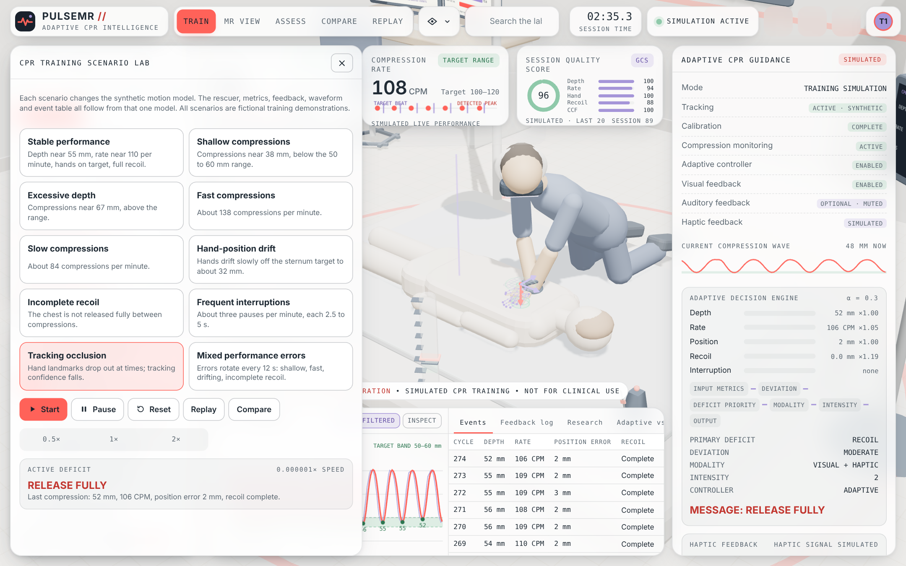</td>
<td width="50%">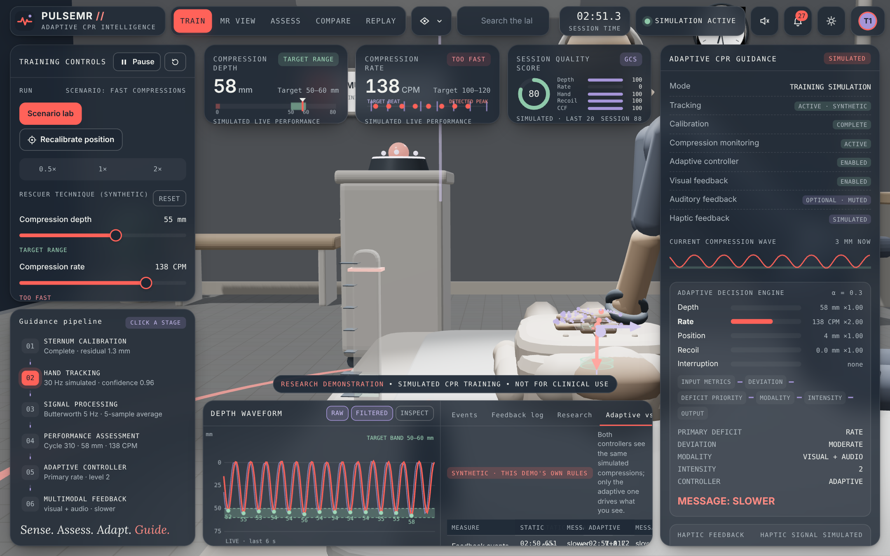</td>
</tr>
<tr>
<td><b>Scenario lab (key S).</b> Ten scripted scenarios with start, pause, reset, replay and compare controls. <i>Tracking occlusion</i> is selected here: compressions measured mostly from occluded samples are withheld rather than scored. Tracking conditions (lab, low light, occlusion, motion jitter) are switched in the training-controls panel.</td>
<td><b>Dark theme with dimmed lab lighting</b>, side view, <i>Fast compressions</i>. The adaptive-versus-static tab compares both controllers on the same compressions.</td>
</tr>
<tr>
<td>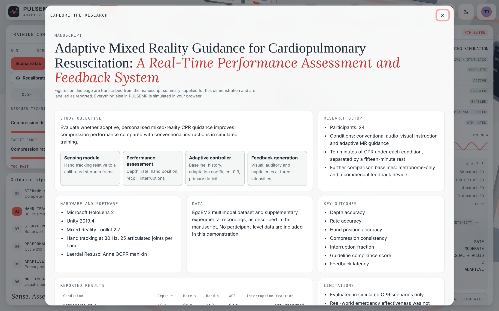</td>
<td>
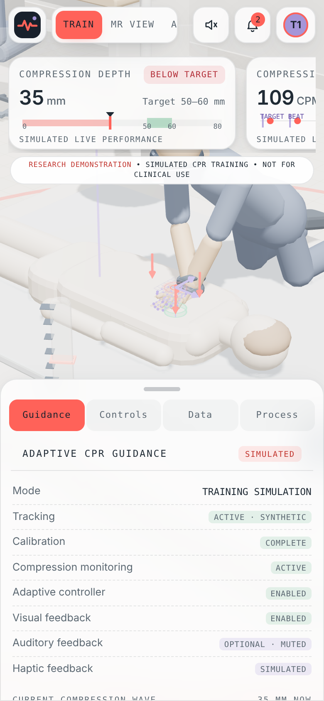
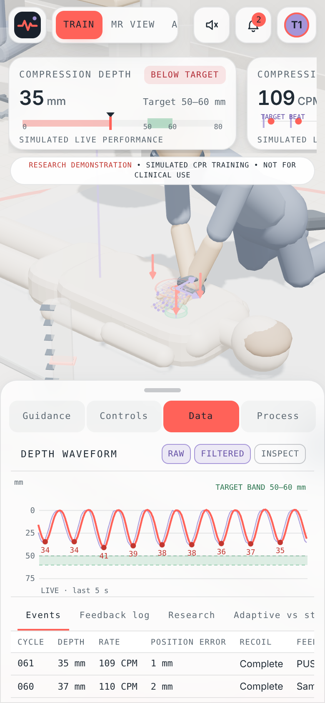
</td>
</tr>
<tr>
<td><b>Research explorer (key E).</b> A summary of the manuscript: architecture, methods, results, limitations, and how this demonstration relates to the study.</td>
<td><b>Phone layout.</b> The panels become bottom sheets (guidance and data).</td>
</tr>
</table>

## How it works

```text
Synthetic rescuer (seeded segments, ground truth)
               |
               v
Tracking model (30 Hz, noise, occlusion, confidence)
               |
               v
Signal processing (Butterworth 5 Hz + 5-sample average)
               |
               v
Assessment (peaks, depth, rate, position, recoil, pauses)
               |
               v
Feedback (adaptive and static controllers)
               |
               v
3D scene + MR overlay + audio + speech + vibration
```

| Stage | What it does | Where |
|---|---|---|
| Synthetic rescuer | Each compression is a raised-cosine segment with its own depth, rate, residual depth (recoil) and hand offset. Pauses are inserted at a set frequency. The motion is seeded and repeatable. | `js/02-simulation.js` · `Gen` |
| Tracking | Samples the palm at 30 Hz. Adds Gaussian noise, a calibration offset, Markov occlusion and jitter, and computes a confidence value. | `takeSample` |
| Filtering | A second-order Butterworth low-pass filter (5 Hz, bilinear transform), plus a 5-sample moving average on x and y. | `butter2`, `Biquad`, `MovingAvg` |
| Detection | A peak/trough state machine with parabolic peak interpolation. Measures rate from peak-to-peak intervals, recoil from the residual depth, and interruptions after 1.2 s without a compression. Low-confidence compressions are withheld. | `Detect` |
| Scoring | Checks each compression against the guideline targets (50–60 mm, 100–120 per minute, ≤ 20 mm hand error, full recoil). The GCS is the mean of five component percentages. | `scoreCycles` |
| Static controller | Reports the first deviating metric in a fixed order, with fixed intensity rules. | `StaticController` |
| Adaptive controller | Keeps a 5-compression baseline and a 10-compression history. Updates personalised weights *w ← 0.7w + 0.3(1 + persistence)* and picks the primary deficit. Lowers intensity when the trainee improves, escalates modality for recurring deficits, suppresses identical repeats, and gives periodic confirmations. | `AdaptiveController` |
| Output | Draws the 3D scene with three.js and charts on canvas. Uses Web Audio, speech synthesis and the Vibration API (where supported). | `js/03`–`js/06` |

The simulation layer (`js/01-core.js` + `js/02-simulation.js`) has no browser dependencies, so the experiment harness runs exactly the same code in Node.js.

## The dataset

`dataset/` holds **PULSEMR-SIM**, which was generated by the simulation layer above. It has two parts.

**`dataset/sessions/`: ten 120-second sessions, one per scenario.** Every session is recorded at full detail:

- 30 Hz samples in three layers (ground truth, tracked and filtered)
- every true compression and pause
- every detected compression, matched to its true counterpart
- every detected pause
- every decision by both controllers

| Scenario | True / detected compressions | Adaptive cues | Static cues | Session GCS |
|---|---|---|---|---|
| Stable performance | 221 / 219 | 0 | 0 | 100.0 |
| Shallow compressions | 221 / 219 | 114 | 219 | 80.0 |
| Excessive depth | 221 / 219 | 113 | 219 | 80.0 |
| Fast compressions | 276 / 275 | 167 | 274 | 80.0 |
| Slow compressions | 168 / 167 | 84 | 166 | 80.0 |
| Hand-position drift | 221 / 219 | 101 | 201 | 81.6 |
| Incomplete recoil | 221 / 219 | 216 | 219 | 80.0 |
| Frequent interruptions | 198 / 197 (4 / 4 pauses) | 5 | 5 | 97.9 |
| Tracking occlusion | 220 / 203 (45 withheld) | 27 | 27 | 96.6 |
| Mixed performance errors | 237 / 236 | 145 | 236 | 79.7 |

**`dataset/experiments/`: the experiments behind the manuscript.**

- **E1:** measurement accuracy over 57,516 true compressions in 11 tracking conditions
- **E2:** interruption detection in v1.1 and the defective v1.0
- **E3:** 2,400 feedback-policy runs, including ablations
- **E5:** computational cost

For the column-by-column dictionary, see [`dataset/README.md`](dataset/README.md). For methods, validation and figures, see the paper: [PDF](docs/paper/PULSEMR-SIM_dataset_paper.pdf) · [Word](docs/paper/PULSEMR-SIM_dataset_paper.docx).

```python
import pandas as pd
c = pd.read_csv("dataset/sessions/shallow/compressions.csv")
print(c[["depth_mm", "true_depth_mm", "rate_cpm", "status", "feedback_shown"]].head())
```

## Reproduce the results

The harness needs only Node.js 18 or later. Nothing to install.

```bash
npm run experiments   # E1, E2 (v1.1 and v1.0), E3, E5  -> dataset/experiments/
npm run sessions      # ten scenario sessions             -> dataset/sessions/
```

| Output | Reproduces |
|---|---|
| `e1_summary.json`, `e1_cycles.csv` | Table 3: measurement accuracy under tracking noise and conditions |
| `e2_summary.json`, `v1.0/e2_summary.json` | Table 4: interruption detection, v1.0 vs v1.1 |
| `e3_summary.json`, `e3_runs.csv`, `e3_onset.json` | Tables 5 and 6: feedback policies and ablations |
| `e5_compute.json` | Computational cost (machine-dependent) |

Both commands together take about a minute on a laptop. Every output except E5 timing is deterministic: the same code gives byte-identical files. Each summary stores the SHA-256 of the simulation code that produced it. For a quick check, run `SEEDS=5 npm run experiments`.

To rebuild the paper's figures and document (requires Python with matplotlib, plus `npm install` for `docx`):

```bash
npm run figures && npm run paper
```

## Learn with PULSEMR

PULSEMR is small enough to read in an afternoon. The **[learning guide](docs/LEARNING_GUIDE.md)** walks through it in six steps:

1. **Explore the app.** Run each scenario and predict the cue before it appears.
2. **CPR quality basics.** Learn what depth, rate, recoil, hand position and compression fraction mean, and why each matters.
3. **Read the signal chain.** Follow one compression from `Gen.at()` to `Detect.finalize()`.
4. **Understand the controllers.** Compare static and adaptive decisions in `feedback.csv`.
5. **Work with the dataset.** Do exercises in Python or a spreadsheet, each with an answer you can check.
6. **Change something.** Add a scenario, tune the filter, or write your own controller, then measure the effect with the harness.

## Project structure

```text
pulsemr/
├── index.html                 app shell (markup only)
├── css/styles.css             all styles, light and dark themes
├── js/                        loaded in this order as classic scripts
│   ├── 01-core.js             constants, guideline targets, reported values, scenarios, state
│   ├── 02-simulation.js       motion model, tracking, filters, detection, scoring, controllers
│   ├── 03-scene.js            three.js lab, manikin, rescuer, equipment
│   ├── 04-frame.js            per-frame animation, camera, picking, overlays
│   ├── 05-charts.js           canvas charts (waveform, trajectory, comparison)
│   ├── 06-feedback-output.js  audio, speech and vibration output
│   ├── 07-interface.js        panels, modes, menus, search, replay, explorer
│   └── 08-main.js             boot and main loop
├── vendor/three/              three.js r147 + OrbitControls (MIT)
├── dataset/                   PULSEMR-SIM (see dataset/README.md)
├── harness/                   Node scripts that generate the dataset
├── tools/                     server, smoke test, screenshot and GIF capture
├── docs/
│   ├── LEARNING_GUIDE.md
│   ├── paper/                 dataset paper (PDF, Word) + figure and build scripts
│   └── screenshots/           README images and demo.gif
├── releases/                  original single-file builds v1.0 and v1.1
├── CHANGELOG.md
└── CITATION.cff
```

## Keyboard shortcuts

| Key | Action |
|---|---|
| `1` to `5` | Train, MR view, Assess, Compare, Replay |
| `Space` | Start or pause the simulation |
| `R` | Recalibrate the sternum reference |
| `S` | Open the scenario lab |
| `E` | Explore the research |
| `A` | Audio on or off |
| `T` | Light or dark theme |
| `B` | Biomechanics overlay on or off |
| `←` `→` | Step through compressions in replay |
| `Esc` | Close panels, clear selection |
| `?` | Show all shortcuts |

## Development

```bash
npm install                     # dev tools only: playwright (tests, screenshots) and docx (paper)
npx playwright install chromium
npm test                        # boots the app headless; checks rendering, calibration, detection, feedback
npm run screenshots             # regenerates docs/screenshots/*.png and the GIF frames
npm run demo-gif                # builds docs/screenshots/demo.gif (Python + Pillow)
```

- **No bundler.** The scripts share one global scope, in the order listed in `index.html`. Keep that order when you add files.
- **Simulation changes.** If you change `js/01-core.js` or `js/02-simulation.js`, rerun `npm run experiments` and `npm run sessions`. The new SHA-256 in the summaries records which code produced the data.

## Citation, licence and disclaimer

If you use PULSEMR or PULSEMR-SIM, please cite it. GitHub's **Cite this repository** button reads [`CITATION.cff`](CITATION.cff).

three.js is © three.js authors, used under the MIT licence (`vendor/three/LICENSE`). <!-- Add a LICENSE file for the PULSEMR code and dataset, e.g. MIT for code and CC BY 4.0 for data. -->

**Disclaimer.** PULSEMR is a research and teaching demonstration. All motion and measurements are simulated. The study results shown in the interface are fixed values reported in the manuscript; the app does not reproduce that study. Nothing here is medical advice or a validated training device. Follow your local resuscitation council's guidelines and certified training.
